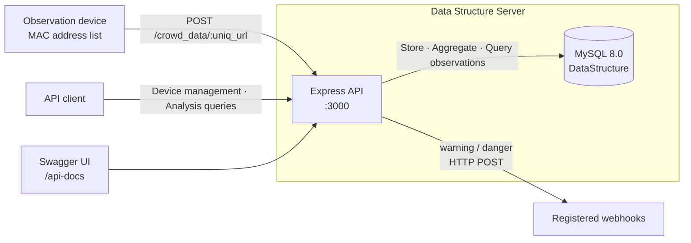

<div align="center">

# Data Structure Server

**English** | [한국어](README.ko.md)

**An API server for analyzing crowd congestion and mobility from Wi-Fi observations**

Per-device headcount estimates · Four-level congestion classification · Neighboring-area headcount prediction · Jaccard-based mobility analysis · Webhook notifications


[Features](#features) · [Architecture](#architecture) · [Quick Start](#quick-start) · [API Usage](#api-usage) · [Project Structure](#project-structure) · [Troubleshooting](#troubleshooting)

</div>

## Overview

The server stores MAC address lists sent by observation devices and estimates the headcount in each area from the number of recently observed unique devices. It classifies congestion using configured thresholds and sends notifications to registered webhooks when the status is warning or danger.

This repository contains the backend for data collection and analysis. It does not include the device software that performs Wi-Fi scans or a visualization frontend. `headcount` represents the number of observed unique devices, not a direct measurement of people.

## Features

| Feature | Description |
|---|---|
| Device management | Register, retrieve, and update device names, installation locations, unique data submission URLs, and congestion thresholds. |
| Headcount estimation | Count unique devices observed by each observation device during the last 60 seconds. |
| Congestion classification | Classify readings as `safe`, `normal`, `warning`, or `danger` using per-device thresholds. |
| Neighboring-area prediction | Compare the two most recent time windows for the current area and its registered neighbors to predict the next window's headcount using simple linear extrapolation. |
| Mobility analysis | Compare consecutive readings from one device or the latest MAC address lists from two devices using Jaccard similarity. |
| Notifications | Save an alert in the database and send an HTTP POST request to each device's webhooks when a reading is `warning` or `danger`. |
| API documentation | Browse request and response specifications in Swagger UI at `/api-docs`. |

## Architecture



### Components

| Component | Role | Technology |
|---|---|---|
| `server.js` | Server startup, router mounting, CORS, JSON parsing, and shared error responses | Node.js, Express |
| `src/router` | Device, crowd data, mobility, and webhook APIs | Express Router |
| `src/utils` | MySQL connection pool, MAC hashing, status classification, and mobility calculations | mysql2, Node.js crypto |
| `src/init.sql` | Database and table initialization | MySQL 8.0 |
| API documentation | Generate and display the OpenAPI specification from router comments | swagger-jsdoc, swagger-ui-express |
| Webhook client | Send notifications to external receiver URLs | Axios |

### Data Model

| Table | Stored Data |
|---|---|
| `devices` | Observation device names, locations, and unique URLs |
| `threshold` | Per-device congestion thresholds |
| `tracked_devices` | SHA-256 MAC hashes and first/last observation timestamps |
| `device_observations` | Records of when and where each tracked device was observed |
| `crowd_data` | Aggregated headcounts, congestion statuses, and MAC address lists at measurement time |
| `device_neighbors` | Directed relationships from a device to its neighboring devices |
| `alerts` | Warning and danger alert history |
| `webhooks` | Per-device notification receiver URLs |

Tracking identifiers are stored as SHA-256 hashes, but the original MAC address lists are also stored in `crowd_data.wifi_list`. Hashing does not remove the original data.

## Quick Start

### Prerequisites

- A Node.js environment based on version 22.19, with npm
- Docker and Docker Compose
- Available host ports `3000` and `3306`

Run the following commands from the repository root. This setup runs the database in Docker and the API locally with Node.js.

### 1. Configure Environment Variables

Set the following values in the root `.env` file. If the file already exists, update only the necessary entries.

```dotenv
DB_HOST=127.0.0.1
DB_ROOT_PASSWORD=replace-with-a-root-password
DB_NAME=DataStructure
DB_USER=ds_user
DB_PASSWORD=replace-with-an-app-password
```

| Variable | Used By | Description |
|---|---|---|
| `DB_HOST` | API | Use `127.0.0.1` locally or `ds-db` on the Compose network |
| `DB_ROOT_PASSWORD` | MySQL container | Initial password for the MySQL root account |
| `DB_NAME` | API | Database name; use `DataStructure` to match the initialization SQL and Compose configuration |
| `DB_USER` | API, MySQL container | Application database user |
| `DB_PASSWORD` | API, MySQL container | Application database password |

The API port is fixed to `3000` in `server.js`. The current database connection code does not read a separate port environment variable, so it uses the default MySQL port, `3306`.

### 2. Start the Database

```bash
docker compose up -d ds-db
docker compose logs -f ds-db
```

Wait for MySQL's `ready for connections` message, then stop following the logs. `src/init.sql` runs when the data volume is first initialized, and data persists in the `db_data` volume.

### 3. Install Dependencies and Start the API

```bash
npm ci
node server.js
```

Check the API from another terminal:

```bash
curl http://localhost:3000/devices
```

A new database returns an empty array, `[]`. Open `http://localhost:3000/api-docs` in your browser to view the API documentation.

### Running the API in a Container

The API service in the current `docker-compose.yaml` specifies `command: npm start`, but `package.json` has no `start` script. Instead of running the full stack with `docker compose up`, explicitly provide the command as shown below. First, confirm that MySQL is ready using the database startup steps above.

```bash
docker compose build ds-server
docker compose run --rm --service-ports ds-server node server.js
```

In this setup, Compose sets the API's `DB_HOST` to `ds-db`. Since `depends_on` does not verify that MySQL is ready to accept requests, use the API only after database initialization has finished.

## API Usage

The base URL is `http://localhost:3000`. Detailed request and response schemas are available at `/api-docs`.

### Endpoints

| Method | Path | Description |
|---|---|---|
| `GET` | `/devices` | List all devices |
| `POST` | `/devices` | Register a device and its congestion thresholds |
| `GET` | `/devices/:id` | Retrieve a device and its thresholds |
| `PUT` | `/devices/:id` | Update device information and thresholds |
| `POST` | `/crowd_data/:uniq_url` | Submit a MAC address list, aggregate the headcount, and generate predictions |
| `GET` | `/crowd_data/:uniq_url/latest` | Retrieve the headcount, status, and predictions based on the last 60 seconds |
| `GET` | `/crowd_data/:uniq_url/history?limit=50` | Retrieve measurement history, up to 200 records |
| `GET` | `/crowd_data/analysis?limit=100` | Group recent measurements by device to analyze mobility trends, up to 1,000 records |
| `GET` | `/mobility/analysis?device1_id=1&device2_id=2&window_seconds=120` | Compare the latest readings from two devices within the specified time window |
| `POST` | `/webhooks` | Register a webhook for a device |
| `GET` | `/webhooks/:device_id` | List webhooks for a device |
| `DELETE` | `/webhooks/:id` | Delete a webhook |

### 1. Register an Observation Device

```bash
curl -X POST http://localhost:3000/devices \
  -H 'Content-Type: application/json' \
  -d '{
    "device_name": "entrance",
    "location": "First-floor entrance",
    "threshold": {
      "safe": 30,
      "normal": 50,
      "warning": 80,
      "danger": 120
    }
  }'
```

Use the response's `id` for subsequent device queries and webhook registration. The host in the `url` field is currently hardcoded to `http://example.com`, so do not call it directly. Copy the final path segment, `entrance_<generated value>`, into `UNIQ_URL` in the next request.

### 2. Submit a MAC Address List and Query Results

```bash
UNIQ_URL='last_path_segment_of_the_response_url'

curl -X POST "http://localhost:3000/crowd_data/$UNIQ_URL" \
  -H 'Content-Type: application/json' \
  -d '["00:11:22:33:44:55", "AA:BB:CC:DD:EE:FF"]'

curl "http://localhost:3000/crowd_data/$UNIQ_URL/latest"
curl "http://localhost:3000/crowd_data/$UNIQ_URL/history?limit=10"
```

The request body must be a non-empty array of MAC address strings. The response includes `headcount`, `status`, `window_seconds`, and `neighbors`. `neighbors` includes the current device; if neighbor relationships are registered in the database, predictions for those devices are also returned.

### 3. Analyze Mobility Between Devices

Register two different devices and submit data from both before running these requests. Replace the IDs below with the actual registered IDs.

```bash
curl 'http://localhost:3000/mobility/analysis?device1_id=1&device2_id=2&window_seconds=120'
curl 'http://localhost:3000/crowd_data/analysis?limit=100'
```

Both devices must have measurement history within the specified time window. `mobility_score` is `1 - Jaccard similarity`: 0 means identical device sets, and 1 means the sets share no devices. This value describes the difference between sets, not the actual direction of movement or the number of people moving.

### 4. Register a Webhook

```bash
curl -X POST http://localhost:3000/webhooks \
  -H 'Content-Type: application/json' \
  -d '{
    "device_id": 1,
    "url": "https://your-domain.example/webhooks/crowd"
  }'
```

Replace `device_id` and `url` with your actual values. Each time the server receives data classified as warning or danger, it sends a JSON payload with these fields:

`deviceId`, `deviceName`, `location`, `crowdDataId`, `headcount`, `status`, `message`, `timestamp`

Webhooks are sent asynchronously, and failures are recorded in the server logs. The current implementation does not retry failed deliveries or suppress duplicate alerts.

## Analysis Rules

### Congestion

The following classifications apply when using the default thresholds.

| Status | Unique Devices in the Last 60 Seconds |
|---|---|
| `safe` | Fewer than 50 |
| `normal` | At least 50, fewer than 80 |
| `warning` | At least 80, fewer than 120 |
| `danger` | At least 120 |

Although the default `safe` threshold is 30, the current classification function compares only `normal`, `warning`, and `danger`. As a result, counts from 30 to 49 are also classified as `safe` with the default configuration.

### Headcount Prediction

- `current`: Unique devices observed during the last 60 seconds
- `previous`: Unique devices observed during the preceding 60 seconds
- `predicted`: `max(0, round(2 × current - previous))`

This prediction simply extrapolates the change between the two windows. Neighbor relationships are managed in the `device_neighbors` table; there is currently no API for registering them.

## Project Structure

```text
data_structure_server/
├── server.js                  Server entry point and Swagger configuration
├── package.json               Dependency definitions
├── package-lock.json          npm dependency lockfile
├── yarn.lock                  Yarn dependency lockfile
├── Dockerfile                 Node.js 22.19 Alpine image
├── docker-compose.yaml        API and MySQL services
└── src/
    ├── init.sql               Initial database schema
    ├── router/
    │   ├── devices.js         Device and threshold management
    │   ├── crowd_data.js      Collection, aggregation, prediction, and history
    │   ├── mobility.js        Mobility analysis between devices
    │   └── webhooks.js        Webhook management
    └── utils/
        ├── db.js              MySQL connection pool
        ├── crowdHelper.js     MAC hashing and analysis functions
        └── asyncHandler.js    Async router error forwarding
```

The current `package.json` has no dedicated development, test, or lint scripts. Start the server with `node server.js`.

## Troubleshooting

| Symptom | What to Check |
|---|---|
| `npm start` fails | No `start` script is defined. Use `node server.js` locally or override the container command as shown above. |
| Database connection fails | Check that MySQL initialization has finished, the connection settings in `.env` are correct, and port `3306` is not in use. |
| Database authentication fails after changing environment variables | Initial MySQL account settings apply only to an empty data volume. Check the existing database accounts. |
| The URL in the device registration response does not work | `example.com` is hardcoded. Append the final path segment to `/crowd_data/` on your actual API server. |
| Mobility analysis returns `404` | Check that two different devices have submitted data within the specified time window. |
| `Threshold not set for this device` | Current collection and latest-reading queries compare the device ID with `threshold.id`, not `threshold.device_id`. Existing data with mismatched IDs can cause this error. |

Check the database container's status and logs with:

```bash
docker compose ps
docker compose logs ds-db
```

For local API logs, check the terminal running `node server.js`. For the containerized API, check the terminal running `docker compose run`.

## Current Scope

Authentication, access control, a dedicated health endpoint, and automated tests are not included. Check server availability at `/devices` or `/api-docs` rather than the API root (`/`).

The features and setup instructions in this document reflect the current repository implementation. The document structure was inspired by the [Proxima VPN Panel README](https://github.com/kimrasng/proxima-vpn/blob/main/README.md).
