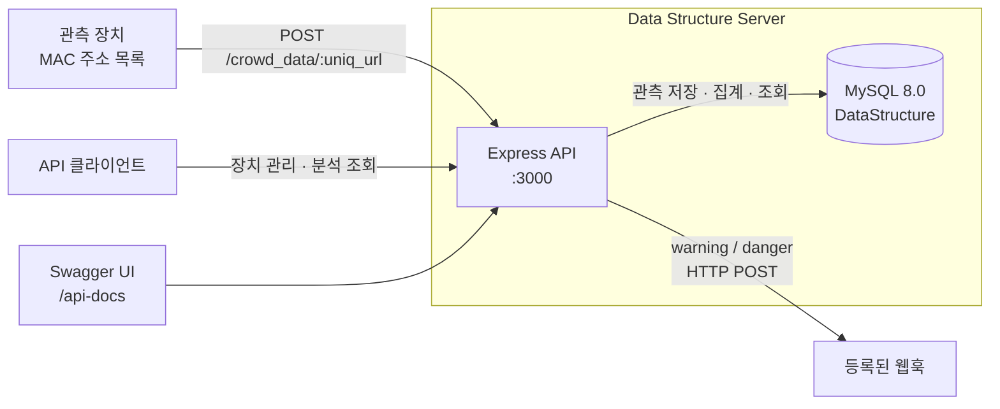

<div align="center">

# Data Structure Server

**Wi-Fi 관측 데이터를 기반으로 군중 혼잡도와 이동성을 분석하는 API 서버**

장치별 인원 추정 · 4단계 혼잡도 분류 · 인접 구역 인원 예측 · Jaccard 기반 이동성 분석 · 웹훅 알림


[주요 기능](#주요-기능) · [아키텍처](#아키텍처) · [빠른 시작](#빠른-시작) · [API 사용법](#api-사용법) · [프로젝트 구조](#프로젝트-구조) · [문제 해결](#문제-해결)

</div>

## 소개

각 관측 장치가 전송한 MAC 주소 목록을 저장하고, 최근 관측된 고유 단말 수로 구역별 인원을 추정합니다. 설정된 기준에 따라 혼잡도를 분류하고, 경고 또는 위험 상태에서 등록된 웹훅으로 알림을 전송합니다.

이 저장소는 데이터 수집·분석을 담당하는 백엔드입니다. Wi-Fi 스캔을 수행하는 장치 프로그램과 시각화 프런트엔드는 포함하지 않습니다. `headcount`는 실제 사람 수를 직접 측정한 값이 아니라 관측된 고유 단말 수입니다.

## 주요 기능

| 기능 | 설명 |
|---|---|
| 장치 관리 | 장치 이름, 설치 위치, 데이터 전송용 고유 URL과 혼잡도 기준을 등록·조회·수정합니다. |
| 인원 추정 | 장치별 최근 60초 동안 관측된 고유 단말 수를 집계합니다. |
| 혼잡도 분류 | 장치별 임계값으로 `safe`, `normal`, `warning`, `danger`를 판정합니다. |
| 인접 구역 예측 | 현재 구역과 등록된 인접 구역의 최근 두 시간 구간을 비교해 다음 구간 인원을 단순 선형 예측합니다. |
| 이동성 분석 | 같은 장치의 연속 측정값 또는 두 장치의 최신 MAC 목록을 Jaccard 유사도로 비교합니다. |
| 알림 전송 | `warning` 또는 `danger` 측정 시 알림을 DB에 저장하고 장치별 웹훅에 HTTP POST 요청을 보냅니다. |
| API 문서 | `/api-docs`에서 Swagger UI로 요청·응답 명세를 확인할 수 있습니다. |

## 아키텍처



### 구성 요소

| 구성 | 역할 | 기술 |
|---|---|---|
| `server.js` | 서버 시작, 라우터 연결, CORS, JSON 파싱, 공통 오류 응답 | Node.js, Express |
| `src/router` | 장치·군중 데이터·이동성·웹훅 API | Express Router |
| `src/utils` | MySQL 연결 풀, MAC 해시, 상태 판정, 이동성 계산 | mysql2, Node.js crypto |
| `src/init.sql` | 데이터베이스와 테이블 초기화 | MySQL 8.0 |
| API 문서 | 라우터의 주석으로 OpenAPI 명세 생성 및 표시 | swagger-jsdoc, swagger-ui-express |
| 웹훅 클라이언트 | 외부 수신 URL로 알림 전송 | Axios |

### 데이터 모델

| 테이블 | 저장 내용 |
|---|---|
| `devices` | 관측 장치 이름, 위치, 고유 URL |
| `threshold` | 장치별 혼잡도 임계값 |
| `tracked_devices` | SHA-256 MAC 해시와 최초·최종 관측 시각 |
| `device_observations` | 단말이 어느 장치에서 언제 관측되었는지 기록 |
| `crowd_data` | 집계 인원, 혼잡도 상태, 측정 시점 MAC 목록 |
| `device_neighbors` | 기준 장치에서 인접 장치로의 방향성 관계 |
| `alerts` | 경고·위험 알림 이력 |
| `webhooks` | 장치별 알림 수신 URL |

추적 식별자는 SHA-256 해시로 저장하지만, 원본 MAC 목록도 `crowd_data.wifi_list`에 저장합니다. 해시 처리만으로 원본 데이터가 제거되지는 않습니다.

## 빠른 시작

### 준비 사항

- Node.js 22.19 기준 실행 환경과 npm
- Docker 및 Docker Compose
- 사용 가능한 호스트 포트 `3000`, `3306`

아래 명령은 저장소 루트에서 실행합니다. DB는 Docker로 실행하고 API는 로컬 Node.js로 실행하는 구성입니다.

### 1. 환경 변수 설정

루트의 `.env` 파일에 다음 값을 설정합니다. 기존 파일이 있다면 필요한 항목만 수정합니다.

```dotenv
DB_HOST=127.0.0.1
DB_ROOT_PASSWORD=replace-with-a-root-password
DB_NAME=DataStructure
DB_USER=ds_user
DB_PASSWORD=replace-with-an-app-password
```

| 변수 | 사용처 | 설명 |
|---|---|---|
| `DB_HOST` | API | 로컬 실행 시 `127.0.0.1`, Compose 네트워크에서는 `ds-db` |
| `DB_ROOT_PASSWORD` | MySQL 컨테이너 | MySQL root 계정 초기 비밀번호 |
| `DB_NAME` | API | 데이터베이스 이름. 초기 SQL 및 Compose에 맞춰 `DataStructure` 사용 |
| `DB_USER` | API, MySQL 컨테이너 | 애플리케이션용 DB 사용자 |
| `DB_PASSWORD` | API, MySQL 컨테이너 | 애플리케이션용 DB 비밀번호 |

API 포트는 `server.js`에 `3000`으로 고정되어 있습니다. 현재 DB 연결 코드는 별도 포트 환경 변수를 읽지 않으므로 MySQL 기본 포트 `3306`을 사용합니다.

### 2. 데이터베이스 실행

```bash
docker compose up -d ds-db
docker compose logs -f ds-db
```

로그에서 MySQL의 `ready for connections` 메시지를 확인한 뒤 로그 조회를 종료합니다. `src/init.sql`은 데이터 볼륨을 처음 초기화할 때 실행되며, 데이터는 `db_data` 볼륨에 유지됩니다.

### 3. 의존성 설치 및 API 실행

```bash
npm ci
node server.js
```

다른 터미널에서 확인합니다.

```bash
curl http://localhost:3000/devices
```

새 데이터베이스에서는 빈 배열 `[]`이 반환됩니다. 브라우저에서 `http://localhost:3000/api-docs`를 열면 API 문서를 확인할 수 있습니다.

### API도 컨테이너에서 실행하기

현재 `docker-compose.yaml`의 API 서비스에는 `command: npm start`가 있지만 `package.json`에는 `start` 스크립트가 없습니다. 따라서 전체 `docker compose up` 대신 아래처럼 실행 명령을 명시합니다. 먼저 위의 DB 실행 단계에서 MySQL 준비를 확인합니다.

```bash
docker compose build ds-server
docker compose run --rm --service-ports ds-server node server.js
```

이 구성에서는 Compose가 API의 `DB_HOST`를 `ds-db`로 지정합니다. `depends_on`은 MySQL이 요청을 받을 준비가 되었는지까지 확인하지 않으므로 DB 초기화 완료 후 API를 사용해야 합니다.

## API 사용법

기본 주소는 `http://localhost:3000`입니다. 상세 요청·응답 스키마는 `/api-docs`에서 확인할 수 있습니다.

### 엔드포인트

| 메서드 | 경로 | 설명 |
|---|---|---|
| `GET` | `/devices` | 전체 장치 조회 |
| `POST` | `/devices` | 장치와 혼잡도 기준 등록 |
| `GET` | `/devices/:id` | 장치 및 기준 조회 |
| `PUT` | `/devices/:id` | 장치 정보 및 기준 수정 |
| `POST` | `/crowd_data/:uniq_url` | MAC 목록 전송, 인원 집계 및 예측 |
| `GET` | `/crowd_data/:uniq_url/latest` | 최근 60초 기준 인원·상태·예측 조회 |
| `GET` | `/crowd_data/:uniq_url/history?limit=50` | 측정 이력 조회. 최대 200건 |
| `GET` | `/crowd_data/analysis?limit=100` | 최근 측정값을 장치별로 묶어 이동성 추이 분석. 최대 1,000건 |
| `GET` | `/mobility/analysis?device1_id=1&device2_id=2&window_seconds=120` | 지정 시간 내 두 장치의 최신 측정값 비교 |
| `POST` | `/webhooks` | 장치별 웹훅 등록 |
| `GET` | `/webhooks/:device_id` | 장치별 웹훅 조회 |
| `DELETE` | `/webhooks/:id` | 웹훅 삭제 |

### 1. 관측 장치 등록

```bash
curl -X POST http://localhost:3000/devices \
  -H 'Content-Type: application/json' \
  -d '{
    "device_name": "entrance",
    "location": "1층 입구",
    "threshold": {
      "safe": 30,
      "normal": 50,
      "warning": 80,
      "danger": 120
    }
  }'
```

응답의 `id`는 이후 장치 조회·웹훅 등록에 사용합니다. `url` 필드의 호스트는 현재 코드에서 `http://example.com`으로 고정되어 있으므로 그대로 호출하지 않습니다. 마지막 경로 조각인 `entrance_<생성된 값>`을 복사해 다음 요청의 `UNIQ_URL`에 넣습니다.

### 2. MAC 목록 전송 및 결과 조회

```bash
UNIQ_URL='응답_url의_마지막_경로_조각'

curl -X POST "http://localhost:3000/crowd_data/$UNIQ_URL" \
  -H 'Content-Type: application/json' \
  -d '["00:11:22:33:44:55", "AA:BB:CC:DD:EE:FF"]'

curl "http://localhost:3000/crowd_data/$UNIQ_URL/latest"
curl "http://localhost:3000/crowd_data/$UNIQ_URL/history?limit=10"
```

전송 본문은 비어 있지 않은 MAC 주소 문자열 배열을 사용합니다. 응답에는 `headcount`, `status`, `window_seconds`, `neighbors`가 포함됩니다. `neighbors`에는 현재 장치도 포함되며, DB에 인접 관계가 등록되어 있으면 해당 장치의 예측도 함께 반환합니다.

### 3. 장치 간 이동성 분석

서로 다른 두 장치를 등록하고 양쪽에서 데이터를 전송한 뒤 실행합니다. 아래 ID는 실제 등록 결과에 맞춰 바꿉니다.

```bash
curl 'http://localhost:3000/mobility/analysis?device1_id=1&device2_id=2&window_seconds=120'
curl 'http://localhost:3000/crowd_data/analysis?limit=100'
```

지정 시간 안에 두 장치 모두 측정 이력이 있어야 합니다. `mobility_score`는 `1 - Jaccard 유사도`이며, 0은 동일한 단말 집합, 1은 공통 단말이 없는 집합을 뜻합니다. 이 값은 집합의 차이를 나타내며 실제 이동 방향이나 이동 인원 수를 직접 의미하지는 않습니다.

### 4. 웹훅 등록

```bash
curl -X POST http://localhost:3000/webhooks \
  -H 'Content-Type: application/json' \
  -d '{
    "device_id": 1,
    "url": "https://your-domain.example/webhooks/crowd"
  }'
```

`device_id`와 `url`을 실제 값으로 바꿉니다. 경고·위험 상태의 데이터를 수신할 때마다 다음 필드를 담은 JSON을 전송합니다.

`deviceId`, `deviceName`, `location`, `crowdDataId`, `headcount`, `status`, `message`, `timestamp`

웹훅은 비동기로 전송하며, 실패는 서버 로그에 기록됩니다. 현재 구현에는 재시도나 중복 알림 억제가 없습니다.

## 분석 기준

### 혼잡도

기본 임계값을 사용했을 때의 판정입니다.

| 상태 | 최근 60초 고유 단말 수 |
|---|---|
| `safe` | 50 미만 |
| `normal` | 50 이상, 80 미만 |
| `warning` | 80 이상, 120 미만 |
| `danger` | 120 이상 |

`safe` 설정값의 기본값은 30이지만, 현재 판정 함수는 `normal`, `warning`, `danger`만 비교합니다. 따라서 기본 설정에서 30~49도 `safe`입니다.

### 인원 예측

- `current`: 최근 60초 동안 관측된 고유 단말 수
- `previous`: 그 직전 60초 동안 관측된 고유 단말 수
- `predicted`: `max(0, round(2 × current - previous))`

이 예측은 단순한 변화량 연장입니다. 인접 장치 관계는 `device_neighbors` 테이블에서 관리하며, 현재 이를 등록하는 API는 없습니다.

## 프로젝트 구조

```text
data_structure_server/
├── server.js                  서버 진입점 및 Swagger 설정
├── package.json               의존성 정의
├── package-lock.json          npm 의존성 잠금 파일
├── yarn.lock                  Yarn 의존성 잠금 파일
├── Dockerfile                 Node.js 22.19 Alpine 이미지
├── docker-compose.yaml        API 및 MySQL 서비스
└── src/
    ├── init.sql               데이터베이스 초기 스키마
    ├── router/
    │   ├── devices.js         장치와 임계값 관리
    │   ├── crowd_data.js      데이터 수집, 집계, 예측, 이력
    │   ├── mobility.js        장치 간 이동성 분석
    │   └── webhooks.js        웹훅 관리
    └── utils/
        ├── db.js              MySQL 연결 풀
        ├── crowdHelper.js     MAC 해시 및 분석 함수
        └── asyncHandler.js    비동기 라우터 오류 전달
```

현재 `package.json`에는 별도 개발·테스트·린트 스크립트가 없습니다. 실행은 `node server.js`를 사용합니다.

## 문제 해결

| 증상 | 확인할 내용 |
|---|---|
| `npm start` 실패 | 등록된 `start` 스크립트가 없습니다. 로컬에서는 `node server.js`, 컨테이너에서는 위의 명령 재정의 방식을 사용합니다. |
| DB 연결 실패 | MySQL 초기화 완료 여부, `.env`의 접속 정보, `3306` 포트 충돌을 확인합니다. |
| 환경 변수 변경 후 DB 인증 실패 | MySQL 초기 계정 설정은 빈 데이터 볼륨에서만 적용됩니다. 기존 DB 계정을 확인해야 합니다. |
| 장치 등록 응답의 URL 접속 실패 | `example.com`은 고정 문자열입니다. 마지막 경로 조각을 실제 API 서버의 `/crowd_data/` 뒤에 붙입니다. |
| 이동성 분석에서 `404` 반환 | 서로 다른 두 장치가 지정 시간 안에 데이터를 전송했는지 확인합니다. |
| `Threshold not set for this device` | 현재 수집·최신 조회는 `threshold.device_id`가 아니라 `threshold.id`와 장치 ID를 비교합니다. 두 ID가 어긋난 기존 데이터에서는 오류가 발생할 수 있습니다. |

DB 컨테이너 상태와 로그는 다음 명령으로 확인합니다.

```bash
docker compose ps
docker compose logs ds-db
```

로컬 API 로그는 `node server.js`를 실행한 터미널에서 확인합니다. 컨테이너 API는 `docker compose run`을 실행한 터미널에서 확인합니다.

## 현재 구현 범위

인증·접근 제어, 별도 상태 확인 엔드포인트, 자동화 테스트는 포함되어 있지 않습니다. API 루트(`/`) 대신 `/devices` 또는 `/api-docs`로 실행 상태를 확인합니다.

이 문서의 기능과 실행 안내는 현재 저장소 구현을 기준으로 작성했습니다. 문서 구성은 [Proxima VPN Panel README](https://github.com/kimrasng/proxima-vpn/blob/main/README.md)를 참고했습니다.
